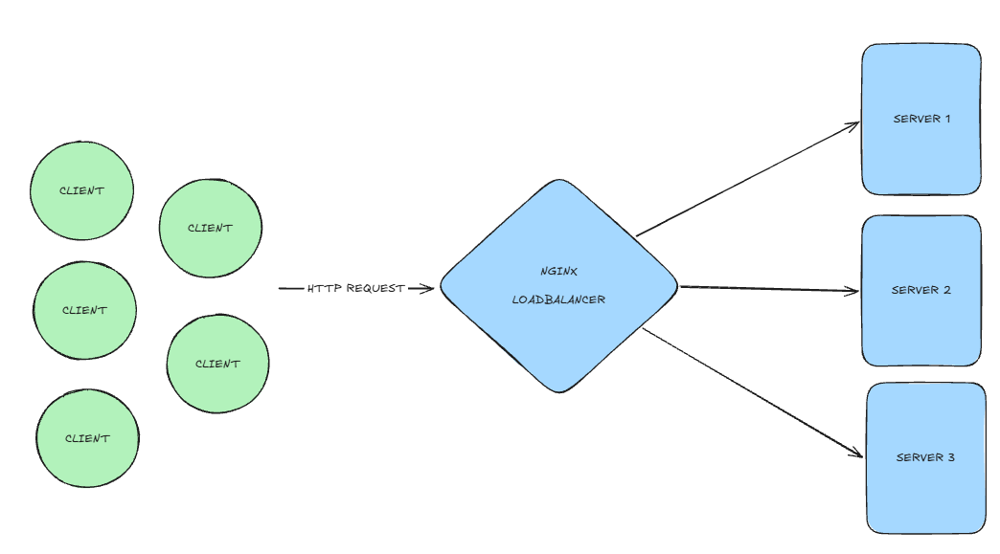

# NGINX + NODE + DOCKER - LOAD BALANCE BASIC STRUCTURE

## objective
This repo i created to study a simple loadbalancing with nginx to horizontal scaling apps,
in this template i inderstood a working layout os loadbalancing and how i made to configuring
in nginx + docker in real life cloud applications

## how it works
The working scheme of loadbalancer is a simples concept, basically you recept
a some requests ( http in this case ), the nginx server get all then and distribute
this requests in your machines on your application runs with equally

## requirements
- docker installed
- node installed

## how execute
to run this scrtucture:

- clone this repo
- go to cloned folder
- in app1, app2, app3 run npm i to install all dependencies to express.js works
- run docker compose up
- access in your browser localhost:8080 and see magic works

